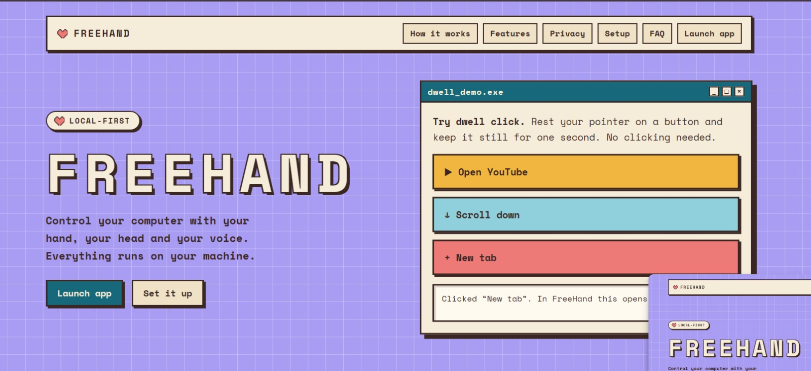
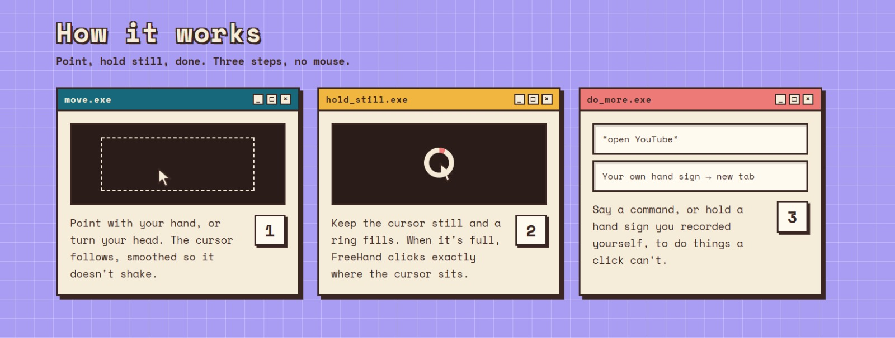
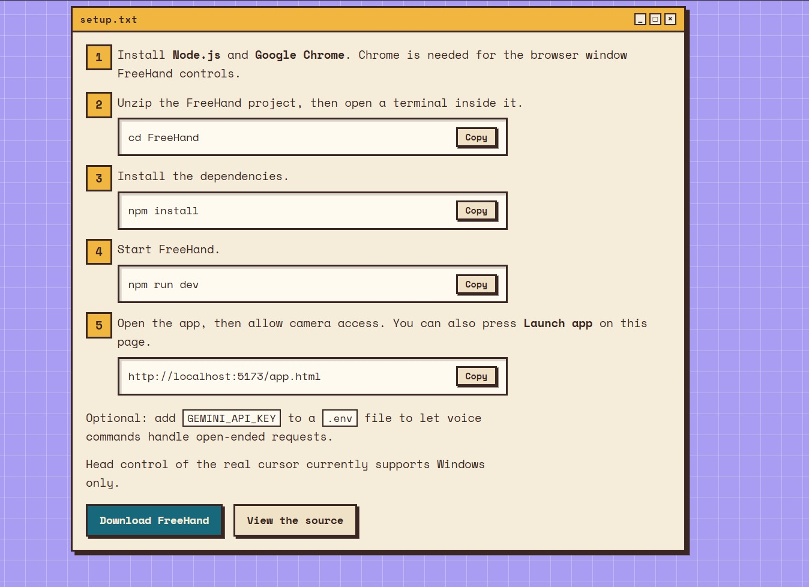
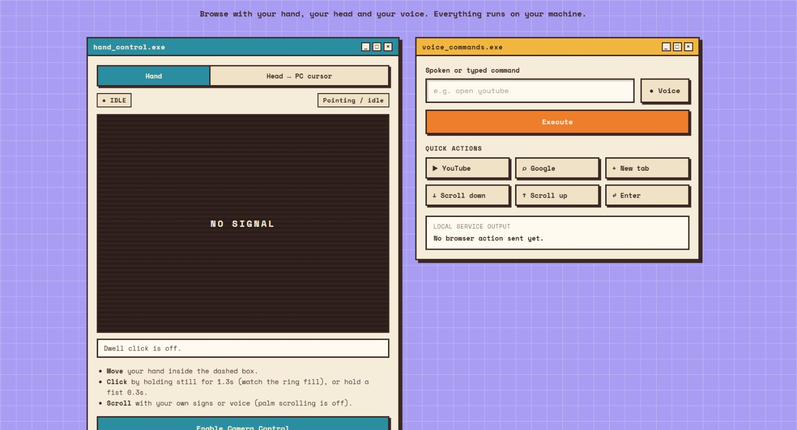
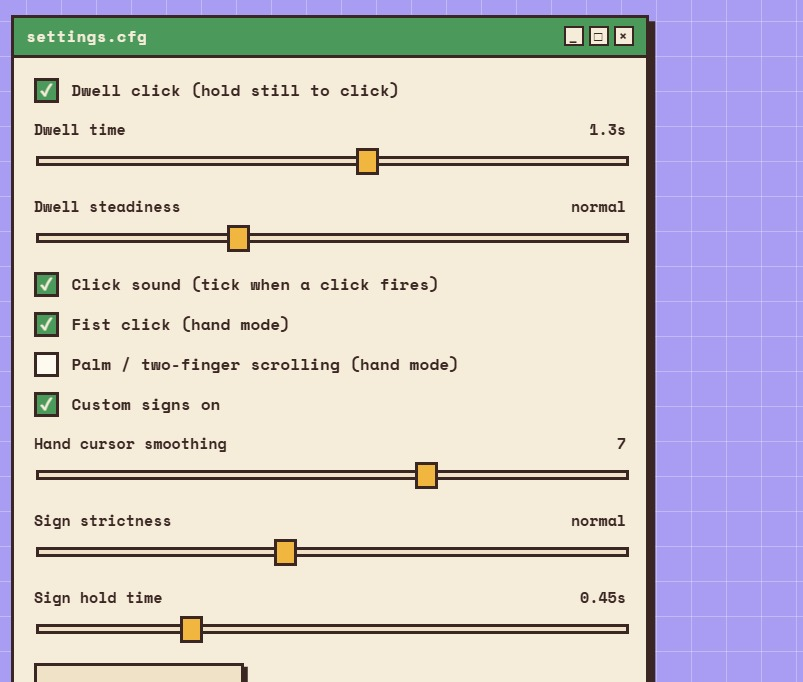
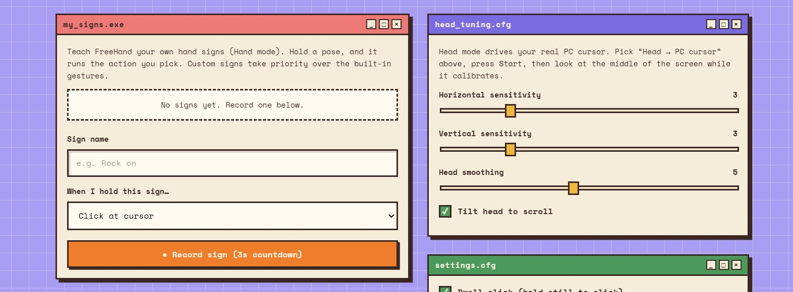
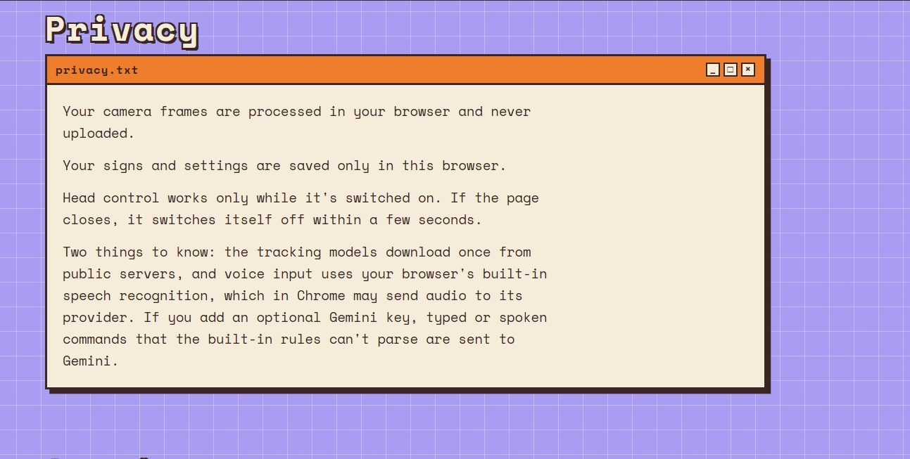

 FreeHand

Control your computer with your **hand**, your **head** and your **voice**. Local-first: camera frames are processed in your browser and never uploaded.

## Features

- **Hand control**: move a cursor with your hand through your webcam, with smoothing and fist click.
- **Head control**: turn and tip your head to move your real Windows cursor.
- **Dwell click**: hold still and it clicks, exactly where the cursor is locked.
- **Custom signs**: record your own hand signs and map them to actions.
- **Voice commands**: say or type what you want; common commands work out of the box.

## How it works?

Point, hold still, done. Move with your hand or head, keep the cursor still while a ring fills and FreeHand clicks, or use a voice command or custom sign for things a click can't do.

## Quick start

1. Install Node.js 22 or newer and Google Chrome (Chrome is used for the browser window FreeHand controls).
2. Run `npm install`.
3. Optional: copy `.env.example` to `.env` and add `GEMINI_API_KEY` for Gemini-powered command parsing. Direct commands such as `open YouTube` work without it.
4. Run `npm run dev`.
5. Open `http://localhost:5173` for the landing page, or `http://localhost:5173/app.html` for the app, and allow camera access.

Head control of the real cursor supports **Windows only**.

## The app

The client uses MediaPipe in the browser for hand and face landmarks. A local Node service validates actions and drives a dedicated Chrome window through Playwright.

## Controls

### Hand control

- Move your hand inside the dashed box on the camera preview to move the cursor. Point with one finger to move without triggering scroll.
- **Fist click:** hold a closed fist for 0.3s. The cursor locks where it was just before the fist formed.
- Open palm scrolls down, two fingers scroll up (off by default, can be switched on in settings).

### Dwell click

Hold still and it clicks. After about a third of the dwell time the cursor freezes in place, so tremor cannot move it and the click lands exactly where you see it. "Dwell steadiness" controls how much wobble still counts as holding still. Palm and two-finger scrolling are off by default, because an open hand is a natural pose and used to scroll constantly.

### Custom signs

In the `my_signs.exe` panel: name a sign, choose an action (click, scroll, back/forward, tabs, a key shortcut such as `Control+L`, typed text, or any voice command such as `open youtube`), press **Record**, and hold the pose through the 3-2-1 countdown. Hold the pose for about half a second later to trigger it.

Signs and settings are saved in this browser (localStorage). Tips: use clearly different hand shapes, keep the same hand you recorded with, and record in the lighting you will use. Custom signs take priority over the built-in gestures.

### Head control (moves your real PC cursor)

Pick **Head → PC cursor**, press **Start Head Control**, and look at the middle of your screen while it calibrates (about 2s). Turn and tip your head to move the cursor across the whole screen (primary monitor, Windows only).

- **Click:** hold still; a tick sounds when the click fires (dwell, same engine as hand mode).
- **Scroll:** tilt your head to a shoulder (right = down, left = up). Turn it off in `head_tuning.cfg`.
- **Recenter:** press the button or R if your resting position drifts. **Stop:** the button, or Esc with the page focused.
- Tune horizontal/vertical sensitivity and smoothing in `head_tuning.cfg`.

### Voice and typed commands

- `search <query>`
- `scroll down` / `scroll up`, `scroll the page up`, `page down`
- `back` / `forward`
- `open result <number>`
- `pause`
- `open YouTube` (opens in the default browser)
- `open ChatGPT`, `open github.com`, or `open reddit dot com`
- `play lofi hip hop radio on YouTube` (opens the matching YouTube results)
- `open a new tab`, `close tab` or `press Control W`
- `type hello world`
- `press Control L`, `press Enter`, `press Tab`, or `press ArrowDown`

## Privacy

- Camera frames are processed in your browser and never uploaded.
- Signs and settings are saved only in this browser.
- Head control works only while it is switched on, and switches itself off within about 6 seconds if the page stops sending its heartbeat.
- Things to know: the tracking models download once from public servers; voice input uses your browser's built-in speech recognition, which in Chrome may send audio to its provider; and if you add an optional Gemini key, typed or spoken commands that the built-in rules can't parse are sent to Gemini.
- Raw audio and video are not captured or logged by default.

